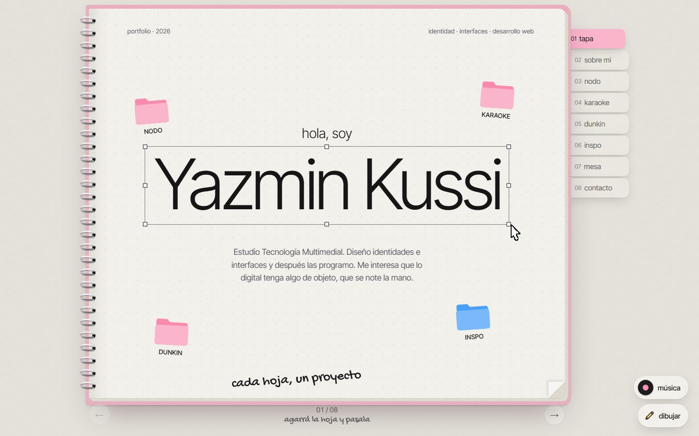
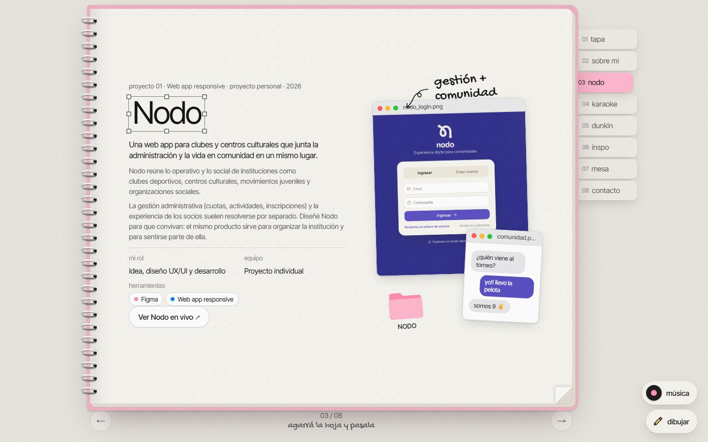
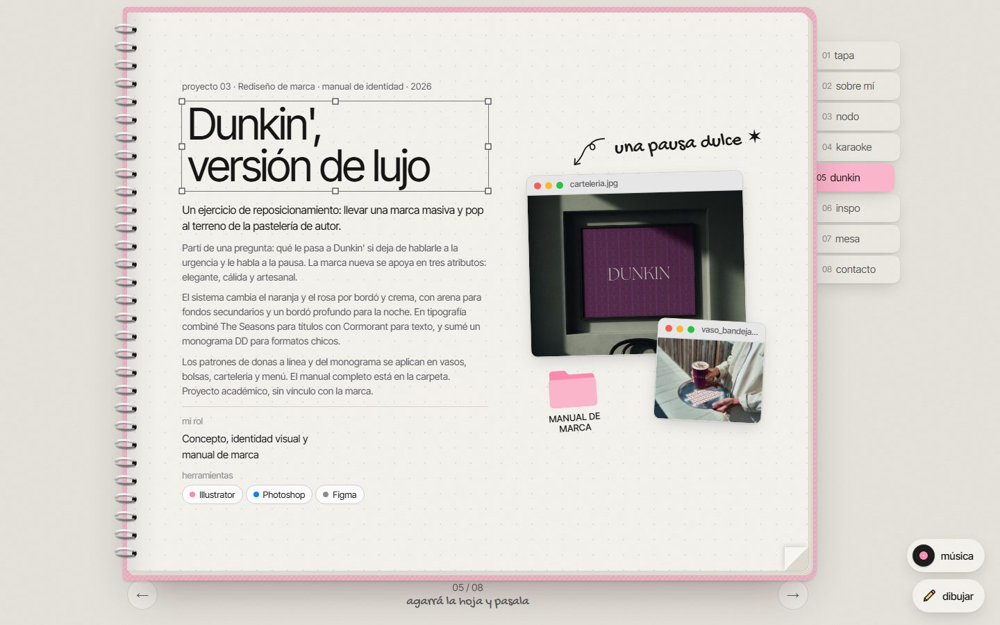
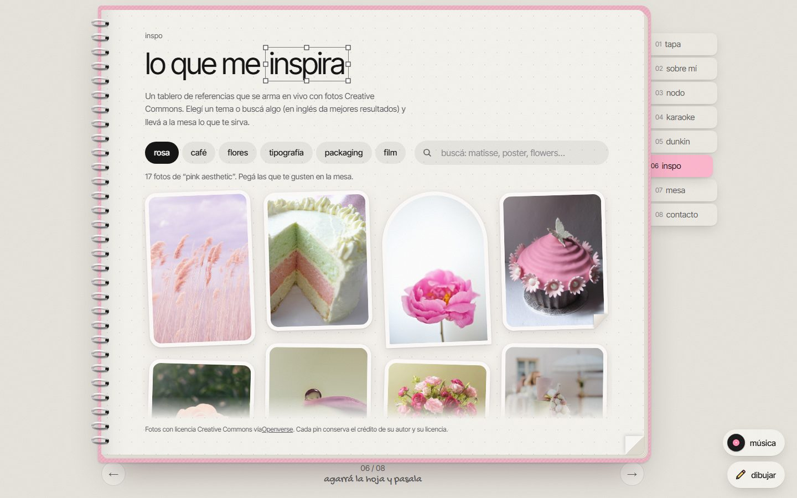
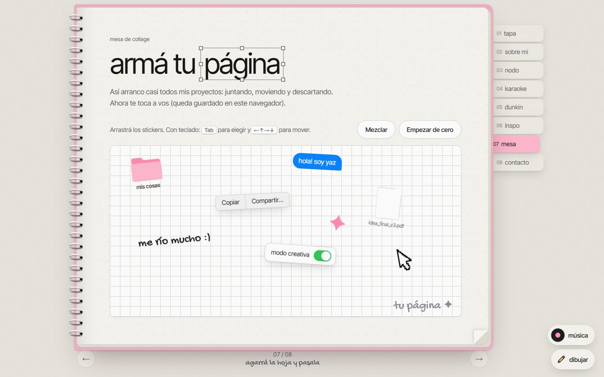
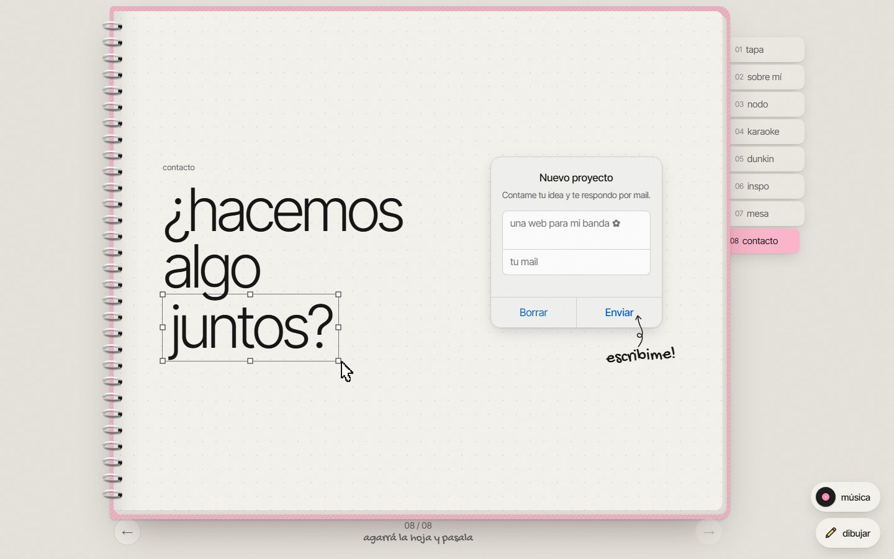
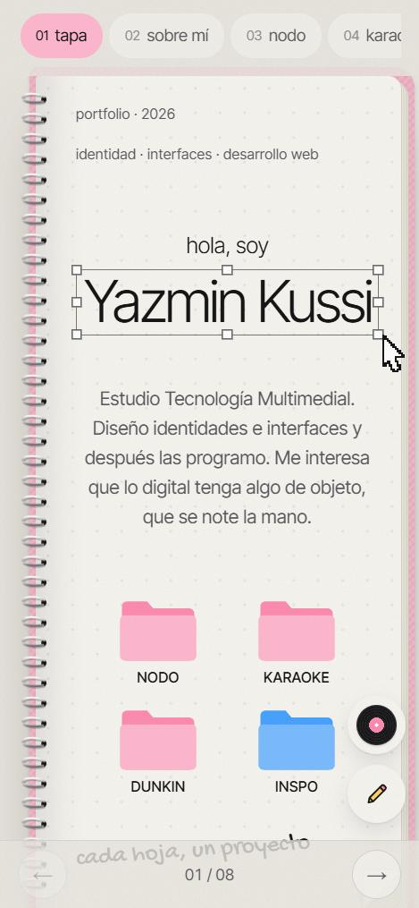
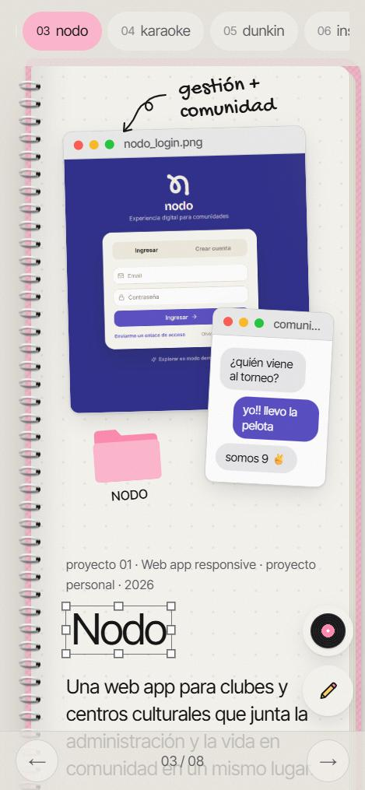
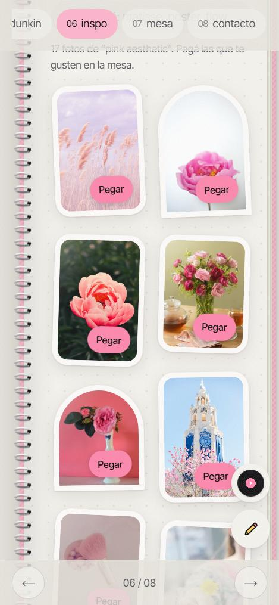
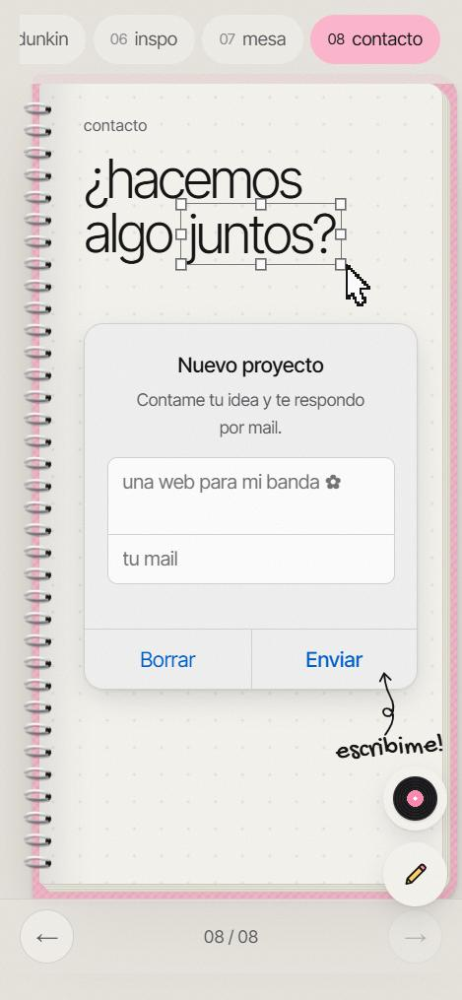

# Bitácora de proceso

> Las partes marcadas con ✍️ las completo yo, con mis palabras.

## 1. El problema de comunicación

Quería un portfolio que no se leyera como un currículum y que mostrara cómo trabajo. Me muevo entre el
diseño visual, la programación y la imagen (foto y video), y fuera de la facu me definen la música, el
arte, el cine y la lectura.

Tenía que sentirse hecho a mano y personal sin perder prolijidad. Colorido, pero no saturado.

## 2. Conceptos explorados

| Concepto | Idea | Por qué sí / por qué no |
| --- | --- | --- |
| Mixtape | El portfolio como reproductor: cada proyecto es un "tema" y se muestra lo que escucho (Last.fm) | Conectaba con la música y el karaoke, pero dejaba afuera lo gráfico |
| Película / créditos | Entrada, escenas y créditos finales, con mis pelis favoritas (TMDB) | Muy audiovisual, pero más lineal y menos interactivo |
| **Fanzine / collage** ✅ | Páginas de un fanzine, stickers, recortes y una mesa para armar tu propio collage | Junta diseño, código e imagen. Es juguetón como yo y deja que quien visita participe |

✍️ _Por qué lo elegí, con mis palabras:_

## 3. Dirección visual

Probé tres estéticas para el fanzine:

- **A · Pastel editorial:** crema, verde salvia, rosa empolvado y serif itálica.
- **B · Risograph suave ✅:** papel claro y dos tintas (rosa y azul) que se superponen con `mix-blend-mode: multiply`.
- **C · Lavanda y mandarina:** lila suave con acentos naranja y notas a mano.

Elegí **B** porque tiene más carácter gráfico (parece impreso de verdad) sin perder suavidad. La paleta
quedó en papel, dos tintas, sus versiones claras y un azul tinta para el texto.

Decisiones que salieron de ahí:
- Sombras **planas y corridas**, como una segunda pasada de tinta, en vez de sombras difusas.
- **Grano de impresión** con un SVG de ruido encima de todo.
- El "corrimiento de registro" en mi apellido: un `text-shadow` rosa desplazado.

### Segunda iteración: del fanzine al cuaderno de escritorio

Con la primera versión armada (fanzine risograph con scroll largo), sentí que le faltaba algo **más
moderno** y más mío. Junté referencias:
- un "recap" de proyectos con carpetas azules, fotos sueltas y un título con **cuadro de selección y
  manijas**, como en un programa de diseño;
- un **cuaderno anillado** con capturas en ventanas de macOS, un diálogo "Nuevo álbum" y **notas a mano
  con flechitas**;
- una hoja de **stickers de interfaz**: carpetas rosas, burbujas de mensaje, archivos, menús Copiar /
  Compartir, interruptores y el cursor pixelado.

Decisiones que tomé a partir de eso:
- El portfolio pasa a ser un **cuaderno donde pasás las hojas**, y **cada hoja es un proyecto**.
- Cambio de paleta: papel claro, negro, **rosa de carpeta** como acento y el azul de sistema para lo
  accionable. Dejé las dos tintas riso.
- Cambio de tipografía: **Inter Tight** fina y con poco espacio entre letras para los títulos (más
  moderna) y **Gochi Hand** para las notas a mano.
- Las capturas de proyectos van dentro de **ventanas de macOS** que hacen de marco de foto.
- Los stickers de la mesa ahora son **stickers de interfaz** (carpeta, burbuja, archivo, menú, switch,
  cursor).
- Sumé el **interruptor profesional / personal** en "sobre mí". Quería que el switch tuviera una función
  real, y la tiene: cambia el texto que leés.

Lo que se mantuvo de la primera versión: la API del museo, los estados, la mesa con física y el criterio
de animación.

### Tercera iteración: agarrar la hoja

Pasar la hoja con un botón se sentía como una página web, no como un cuaderno. Quise que **se pudiera
agarrar la hoja** y que el cuaderno fuera **más realista**.
- Reemplacé la animación fija por un arrastre: la hoja gira en 3D siguiendo la mano y, al soltarla,
  decide si se da vuelta según la posición y la velocidad.
- Sumé el dorso de la hoja, la sombra que proyecta, la luz que cambia al levantarse, un espiral metálico
  con agujeros, la tapa de cartón rosa, el canto de las hojas apiladas, el papel punteado y una esquina
  doblada que se levanta sola una vez para mostrar que se puede agarrar.
- Mantuve pestañas, teclado y dos botones chicos como alternativa: la guía de accesibilidad (WCAG 2.2)
  pide que arrastrar nunca sea la única forma.

✍️ _Qué se siente distinto al usarlo:_

### Cuarta iteración: pulir y completar

- **Cada hoja entra en la pantalla.** En escritorio la hoja ocupa el alto de la ventana y no hace falta
  scrollear. Para lograrlo ajusté tamaños de texto, el ancho de las columnas y el alto de la mesa, y lo
  medí en 1900 × 1000 y en una notebook de 1366 × 768.
- **Inspo pasó a ser un tablero tipo Pinterest.** Grilla masonry, imágenes sin marco, el botón "Pegar"
  aparece al pasar el mouse (en celular queda siempre visible) y el tablero scrollea por dentro.
- **Dos herramientas flotantes.** Un lápiz para dibujar sobre las hojas (el dibujo vive dentro de cada
  hoja, así que gira con ella) y un tocadiscos con la API de iTunes, porque la música también es parte
  de cómo me inspiro.
- **Contacto directo.** El formulario dejó de abrir el programa de correo y ahora envía el mensaje con
  FormSubmit. El servicio se cayó durante las pruebas (500 después de 50 s), así que sumé un aviso de
  demora y un plan B por `mailto:` para que el mensaje no se pierda.
- **Moodboard con estética de Pinterest.** Las piezas del V&A eran grabados y objetos antiguos y no
  transmitían lo que busco. Pasé a Openverse con fotos verticales y temas como rosa, café, flores,
  tipografía, packaging y film. Openverse tarda hasta 25 s y a veces falla, así que los temas fijos quedan
  precargados en un archivo y elegí a mano las fotos de cada uno.
- **Inspo en formato sticker.** El tablero tipo Pinterest quedaba prolijo pero frío, muy de app. Pasé
  las fotos a stickers: borde blanco troquelado, un giro leve distinto para cada una, sombra de papel y
  un brillo de vinilo. Algunas tienen forma de arco y otras una esquina despegada que deja ver el dorso.
  Así el tablero conversa con la mesa de collage y con el cuaderno, en vez de parecer otra web. Saqué el
  título debajo de cada foto (los títulos de Flickr suelen ser "IMG_2034"); queda para lectores de pantalla.
- **Mejor en el celular.** Las pestañas quedan fijas arriba y las flechas con el contador fijas abajo, como
  en una app. El espiral es más fino para ganar ancho.
- **Información real en los proyectos.** El karaoke lo reescribí a partir de la presentación y el
  glosario de Redes y Tecnología, y Dunkin' a partir del manual de marca. Del manual saqué dos fotos de
  aplicaciones y una copia liviana del PDF (de 52 MB a 26 MB) que se abre desde la carpeta de la hoja.

## 4. Cómo evolucionó la estructura

1. Primero pensé en secciones clásicas: inicio, sobre mí, proyectos y contacto.
2. Las convertí en **páginas numeradas de un fanzine** (01 a 06), con nombres cortos que entran
   en una barra de celular: hola, yo, trabajos, inspo, mesa y chau.
3. Sumé la **mesa de collage** como interacción principal y la conecté con el moodboard. Así la API
   deja de ser un adorno: alimenta la interacción.
4. En la segunda versión el scroll largo pasó a ser un **cuaderno de 8 hojas** (tapa, sobre mí, tres
   proyectos, inspo, mesa y contacto) que se recorre de a una. Cada proyecto tiene su hoja, generada desde
   `src/data/proyectos.ts`, y la URL guarda la hoja (`#nodo`, `#mesa`).
5. En la cuarta, cada hoja tiene que entrar en la pantalla del escritorio sin scroll, y en el celular la
   navegación queda fija arriba y abajo.

## 5. Interacciones: criterios

Seguí la filosofía de diseño de interfaces de Emil Kowalski:
- ¿Debería animarse? Lo que se repite mucho (mover stickers con teclado) **no** se anima.
- Curvas `ease-out` fuertes (`cubic-bezier(0.23, 1, 0.32, 1)`), nunca `ease-in`.
- Nada aparece desde `scale(0)`: la ficha entra desde `scale(0.96)` con opacidad.
- Botones con `scale(0.97)` al presionar y hover solo con mouse (`@media (hover: hover)`).
- Solo animo `transform` y `opacity`.
- En la mesa, el sticker sigue al dedo 1:1 y al soltarlo tiene inercia. Si es un "flick", sigue
  deslizándose. La inclinación es un resorte, así se siente vivo sin ser exagerado.

## 6. Pruebas en distintos tamaños

| Tamaño | Qué revisé | Resultado |
| --- | --- | --- |
| 375 × 812 (celular) | Pestañas fijas arriba, barra fija abajo, hojas en una columna, stickers en 2 columnas, formulario | Sin scroll horizontal (`scrollWidth` = 375) y todo legible |
| ~800 px (tablet) | Hojas en una y dos columnas, mesa | OK |
| 1366 × 768 (notebook) | Que cada hoja entre sin scroll | Al principio Nodo y Dunkin' se pasaban: compacté textos y márgenes hasta que entraron |
| 1440 × 900, 1900 × 1000, 1920 × 1080 | Lo mismo, más el tablero de inspo que scrollea por dentro | OK |

Las pruebas finales las hice sobre la versión publicada en Vercel, no en local.

**Escritorio (1440 × 900):**

| Tapa | Nodo | Dunkin' |
| --- | --- | --- |
|  |  |  |

| Inspo | Mesa | Contacto |
| --- | --- | --- |
|  |  |  |

**Celular (375 × 812):**

| Tapa | Nodo | Inspo | Contacto |
| --- | --- | --- | --- |
|  |  |  |  |

✍️ _Prueba en mi celular real (modelo y navegador):_

## 7. Problemas y soluciones

- **La API del Art Institute of Chicago dejó de responder desde el navegador.** Devolvía un 403 de
  Cloudflare y el moodboard caía en el estado de error. Lo bueno: el estado de error funcionaba.
  Probé otras APIs: la del Met Museum ya no tiene su buscador (retirado en 2026), así que pasé a la
  del **Victoria and Albert Museum**, que responde bien y tiene CORS abierto.
- **Pedidos encimados.** Si cambiaba de tema rápido, un pedido viejo podía pisar al nuevo. Lo
  resolví guardando un `AbortController` por pedido y cancelando el anterior.
- **"Empezar de cero" duplicaba los eventos de los stickers** porque volvía a inicializarlos. Ahora
  solo reinicia sus posiciones.
- **La cinta tapaba el texto de la nota** en la portada. La moví al borde superior del papel.
- **La barra de Astro en desarrollo tapaba el índice en el celular.** La desactivé en `astro.config.mjs`.
- **El collage no siempre se guardaba** en el navegador de pruebas, porque ahí las animaciones corrían
  muy lento y el guardado esperaba a que el sticker frenara. Ahora también guarda apenas lo soltás.

- **(v2) Una hoja oculta se seguía viendo.** La hoja de contacto aparecía debajo de la tapa porque su
  `display: flex` le ganaba al atributo `hidden`. Lo resolví con una regla `.hoja[hidden] { display: none !important }`.
- **(v2) La mesa empezaba oculta y medía 0 px**, así que los stickers quedaban todos en la esquina. Ahora
  la mesa se arma recién la primera vez que tiene tamaño (`ResizeObserver`). Si pegás una obra antes de
  abrir la mesa, queda anotada en `localStorage` y aparece cuando llegás.
- **(v2) Animaciones de hoja que se pisaban** si pasabas muy rápido. Guardo la animación en curso y,
  si llega otra, la cancelo y dejo todo prolijo antes de empezar la nueva.
- **(v2) En pantallas medianas la hoja de proyecto empezaba con un bloque de texto.** Reordené para que,
  en una columna, abra con el collage visual.

- **(v3) Arrastrar vs. scrollear en el celular.** Si el movimiento empieza vertical, lo dejo scrollear; solo
  si es claramente horizontal (más de 8 px y más horizontal que vertical) "agarro" la hoja.
- **(v3) Arrastrar sobre la mesa o los botones pasaba la hoja.** Excluyo esos elementos del agarre.
- **(v3) La hoja dada vuelta generaba scroll horizontal** al salir por la izquierda: `overflow-x: clip`.

- **(v4) Openverse es lento y se cae.** Una búsqueda nueva tarda 15–25 s y a veces devuelve 500/504; con
  `page_size` mayor a 20 responde 401. Bajar los temas en el build tampoco servía (a veces quedaban vacíos),
  así que los guardé en `src/data/inspo.json` con un script con reintentos, y el buscador en vivo tiene
  un timeout de 30 s y un aviso de "sigue buscando…".
- **(v4) FormSubmit no respondía.** Los primeros envíos tardaban más de 30 s y uno devolvió 500 a los 50 s.
  Sumé el aviso de demora y el plan B por `mailto:`. Después respondió bien y pidió la activación por mail.
- **(v4) El servidor de desarrollo mostraba CSS viejo.** El build tenía el CSS correcto; reiniciar el
  servidor lo resolvió.
- **(v4) Al compactar para que todo entre en pantalla, algunas hojas se volvían a pasar** en notebooks
  de 768 px de alto. Extendí la versión compacta hasta 1040 px de alto y achiqué las pastillas de
  herramientas.
- **(v4) Las imágenes de Dunkin' venían en CMYK** dentro del PDF del manual. Las pasé a RGB y comparé el
  bordó con el del manual antes de usarlas.

## 8. Pendiente / mejorable

- Capturas reales del karaoke y mi foto en "sobre mí" (Nodo y Dunkin' ya tienen imágenes reales).
- ~~Completar mis links de contacto~~ → decidí no mostrar redes ni el mail suelto: el diálogo "Nuevo proyecto" ahora manda el mensaje directo a mi casilla (vía FormSubmit) en vez de abrir el programa de correo de quien visita.
- Sumar más proyectos (hay un lugar reservado: "este espacio está esperando el próximo recorte").
- Exportar el collage como imagen.

## 9. Uso de IA

Usé **Claude (Anthropic)** como asistente durante el proceso.

**Para qué la usé:**
- Leer la consigna y organizar los requisitos.
- Proponer conceptos y direcciones visuales: yo elegí el fanzine y la estética B.
- Generar la primera versión del código de los componentes, el CSS y este README.
- Probar el sitio en el navegador (escritorio y celular) y detectar errores (API bloqueada, cinta
  encima del texto, eventos duplicados).
- Extraer información de mis PDFs (presentación del karaoke y manual de Dunkin') y ajustar la
  redacción de los textos del sitio a partir de lo que yo le pasé.

**Decisiones que tomé yo:**
- El concepto (primero fanzine / collage, después cuaderno de escritorio) y la estética.
- Las referencias visuales de la segunda versión (las busqué y se las pasé).
- Qué proyectos mostrar y cómo describirlos (Nodo, Karaoke y el rediseño de Dunkin').
- Que se sintiera estético y "colorido pero no tanto".
- Aplicar la filosofía de diseño de Emil Kowalski.

**Qué revisé, cambié o descarté:**
- Descarté la primera fuente del moodboard (V&A): funcionaba, pero las imágenes no tenían nada que ver
  con mi estética. Pedí algo tipo Pinterest y después que fueran stickers.
- Corregí las herramientas de Dunkin' (Illustrator, Photoshop y Figma) y decidí que el manual se abra
  desde la carpeta rosa.
- Pedí reescribir todos los textos porque sonaban genéricos, "a IA". Mi texto personal de "sobre mí" no
  se tocó.
- Saqué la firma del pie de contacto y los links de redes: decidí dejar solo el formulario a mi mail.
- Pedí que todo entre en una pantalla sin scroll y que en el celular se pueda navegar mejor.

**Errores o límites de la IA que detecté:**
- Propuso APIs que después fallaron (Art Institute bloqueado por Cloudflare, Openverse lento) y hubo que
  cambiar de estrategia sobre la marcha.
- Algunos ajustes de tamaño arreglaban una pantalla y rompían otra: hubo que medir en varias
  resoluciones antes de dar algo por terminado.
- No podía ver todo en vivo: con el panel del navegador oculto las imágenes no cargaban, así que algunas
  cosas las revisé yo en mi compu y en el celular.
- Escribía textos correctos pero con tono de IA; los tuve que pedir de nuevo con otra voz.

✍️ _Qué partes del código puedo explicar y modificar (repasar antes de la defensa):_
